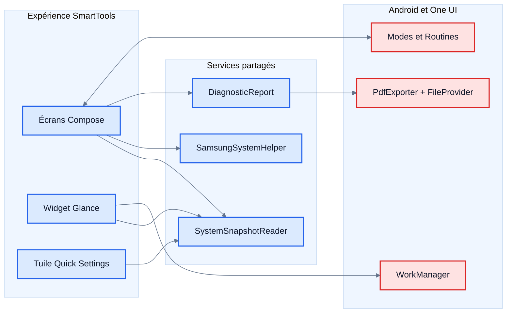
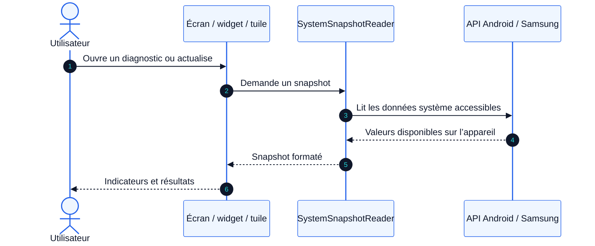

<a id="top"></a>

<div align="center">

# ⚡ SmartTools

### **L’essentiel du diagnostic Galaxy, dans une interface pensée pour One UI.**

Une boîte à outils Android moderne pour **comprendre**, **tester** et **piloter** votre Samsung Galaxy — du diagnostic matériel au widget, en passant par les tests OLED, tactiles et S-Pen.

**Open source · Sans publicité · Sans télémétrie · Conçue pour Samsung Galaxy**

<br/>

[](https://github.com/teremuhamblin/SmartTools/releases)
[](#compatibilite)
[](#compatibilite)
[](#architecture)

[](https://github.com/teremuhamblin/SmartTools/commits/main)
[](https://github.com/teremuhamblin/SmartTools/issues)
[](LICENSE)

<br/>

[**Découvrir les nouveautés**](#nouveautes) · [**Fonctionnalités**](#fonctionnalites) · [**Architecture**](#architecture) · [**Installation**](#installation) · [**Sécurité**](#securite) · [**Contribuer**](#contribuer)

</div>

---

> **Identité visuelle du projet** — une esthétique inspirée des interfaces IA modernes : surfaces sobres, contrastes nets, accents **bleu électrique** pour la technologie et **rouge** pour les alertes et la sécurité. La typographie suit celle de GitHub : les dépôts n’autorisent pas l’intégration fiable de polices personnalisées dans leur rendu Markdown.

## Sommaire

- [À propos](#apropos)
- [Nouveautés de la v1.2.0](#nouveautes)
- [Fonctionnalités principales](#fonctionnalites)
- [Architecture](#architecture)
- [Historique des versions](#historique)
- [Compatibilité](#compatibilite)
- [Installation](#installation)
- [Confidentialité et sécurité](#securite)
- [Contribuer](#contribuer)
- [Licence](#licence)

---

<a id="apropos"></a>
## 📖 À propos

**SmartTools** est une application Android open source développée en **Kotlin**, **Jetpack Compose** et **Jetpack Glance**, dédiée aux smartphones, tablettes et appareils pliables **Samsung Galaxy**.

Elle réunit dans une seule expérience les informations utiles sur l’appareil, des outils de test matériel, des raccourcis d’optimisation et des intégrations à l’écosystème **One UI**. L’interface est conçue pour être lisible, adaptée aux formats Galaxy et cohérente avec les usages Samsung.

### En un coup d’œil

| | Ce que SmartTools apporte |
|:--|:--|
| **Diagnostiquer** | Informations appareil, mémoire, batterie et état thermique. |
| **Tester** | Outils interactifs pour l’écran OLED, le tactile et le S-Pen compatible. |
| **Consulter** | Widget d’accueil et tuile de réglages rapides pour accéder aux indicateurs. |
| **Automatiser** | Raccourcis et alertes utilisables avec Samsung Modes et Routines. |
| **Partager** | Rapport de diagnostic exportable au format PDF. |

---

<a id="nouveautes"></a>
## 🚀 Nouveautés de la v1.2.0

> [!IMPORTANT]
> La v1.2.0 rassemble le widget d’accueil, les intégrations Modes et Routines et les tests interactifs d’écran et de S-Pen autour d’une lecture système partagée.

### 📊 Widget One UI

- Widget développé avec **Jetpack Glance**, disponible en formats **2×1** compact et **4×1** détaillé.
- Affichage des informations de mémoire, batterie et température disponibles dans l’application.
- Actualisation à la demande et mises à jour planifiées via **WorkManager** lorsque le widget est utilisé.
- Prise en charge du thème clair ou sombre et des couleurs dynamiques.

### ⚙️ Samsung Modes et Routines

- Trois **App Shortcuts** : diagnostic rapide, test écran/S-Pen et optimisation.
- Raccourcis profonds `smarttools://route/...` pour ouvrir les parcours concernés.
- Canaux d’alerte dédiés aux événements suivis, notamment température élevée et mémoire critique.

### ✍️ Tests OLED, tactile et S-Pen

- Mires plein écran pour examiner l’affichage et repérer d’éventuelles irrégularités visibles.
- Test tactile multi-touch avec visualisation sur une matrice **10×20**.
- Informations du stylet lorsqu’un S-Pen compatible est détecté : type d’outil, pression, inclinaison, survol et bouton latéral.
- Restauration des paramètres temporaires de luminosité à la sortie du test.

### 📄 Rapports et réglages rapides

Les résultats disponibles sont intégrés au modèle `DiagnosticReport` et à l’export PDF. La tuile `QuickTileService` exploite également le snapshot système partagé pour afficher un sous-titre contextualisé.

---

<a id="fonctionnalites"></a>
## ✨ Fonctionnalités principales

| Domaine | Fonctionnalités |
|:--|:--|
| 🔍 **Diagnostic matériel** | Informations sur l’appareil, Android/One UI, processeur, mémoire, stockage et batterie ; jauge thermique selon la version Android ; lecture de l’état Knox lorsque disponible. |
| 📊 **Widget One UI** | Indicateurs de mémoire, batterie et température ; formats `2×1` et `4×1` ; actualisation manuelle et planifiée. |
| 🖊️ **Test de l’écran** | Mires OLED, test multi-touch, prise en charge des événements S-Pen et retour visuel interactif. |
| ⚡ **Accès rapide** | Tuile Quick Settings et outils d’optimisation accessibles depuis l’application. |
| ⚙️ **Automatisation** | Seuils et profils présentés dans l’application, raccourcis d’applications et intégration à Samsung Modes et Routines. |
| 📄 **Rapport** | Export PDF des informations et résultats de diagnostic pris en charge. |
| 🎨 **Expérience Galaxy** | Interface Jetpack Compose, cartes One UI, thème AMOLED noir et traductions française, anglaise et espagnole. |

---

<a id="architecture"></a>
## 🏗️ Architecture

SmartTools s’appuie sur un **lecteur de snapshot système commun** afin de partager les indicateurs entre les écrans, le widget et la tuile rapide. Les composants d’interface délèguent les tâches dédiées aux utilitaires, aux services Android et aux intégrations One UI.



### Parcours des données



<details>
<summary><strong>📂 Arborescence principale de <code>app/src/</code></strong></summary>

```text
app/src/
├── main/
│   ├── AndroidManifest.xml
│   ├── java/com/smarttools/samsung/
│   │   ├── MainActivity.kt
│   │   ├── data/
│   │   │   ├── DeviceSpecs.kt
│   │   │   └── DiagnosticReport.kt
│   │   ├── service/
│   │   │   └── QuickTileService.kt
│   │   ├── widget/
│   │   │   ├── SmartToolsWidget.kt
│   │   │   ├── SmartToolsWidgetReceiver.kt
│   │   │   └── WidgetUpdateWorker.kt
│   │   ├── theme/
│   │   │   ├── Color.kt
│   │   │   └── Theme.kt
│   │   ├── ui/
│   │   │   ├── components/
│   │   │   │   ├── OneUiCard.kt
│   │   │   │   ├── ThermalGauge.kt
│   │   │   │   └── TouchMatrixView.kt
│   │   │   └── screens/
│   │   │       ├── AutomationScreen.kt
│   │   │       ├── DiagnosticScreen.kt
│   │   │       ├── OptimizationScreen.kt
│   │   │       └── TouchTestScreen.kt
│   │   └── utils/
│   │       ├── BatteryHelper.kt
│   │       ├── PdfExporter.kt
│   │       ├── QuickSystemSnapshot.kt
│   │       ├── RoutineNotifier.kt
│   │       └── SamsungSystemHelper.kt
│   └── res/xml/
│       ├── file_paths.xml
│       ├── shortcuts.xml
│       └── smart_tools_widget_info.xml
└── test/java/com/smarttools/samsung/
    └── DiagnosticReportTest.kt
```

</details>

---

<a id="historique"></a>
## 📜 Historique des versions

| Version | Date | Points forts |
|:--:|:--:|:--|
| **v1.2.0** | Nov. 2026 | Widget Jetpack Glance, intégration Modes et Routines, test OLED/tactile/S-Pen et enrichissement des rapports. |
| **v1.1.0** | Fév. 2025 | Export PDF, tuile Quick Settings, automatisations et langues FR/EN/ES. |
| **v1.0.3** | Jan. 2025 | Alertes de charge, indicateurs d’optimisation et cible Android 15 (SDK 35). |
| **v1.0.2** | Déc. 2024 | État Knox, jauge thermique, thème AMOLED et améliorations Galaxy Z Flip. |
| **v1.0.1** | Déc. 2024 | Compatibilité Android 8–10, permissions de notification et adaptations d’affichage. |
| **v1.0.0** | Nov. 2024 | Première version : écrans Diagnostic, Optimisation et Automatisation. |

---

<a id="compatibilite"></a>
## 📱 Compatibilité

- **Appareils ciblés :** smartphones Samsung Galaxy, Galaxy Z Flip, Galaxy Z Fold et tablettes Galaxy Tab.
- **Android minimum :** Android 8.0 (**API 26**).
- **Versions One UI visées :** One UI 4.x à 7.x.
- **S-Pen :** les fonctions dépendent de la compatibilité matérielle de l’appareil et du stylet.

La disponibilité et la précision de certaines données système peuvent varier selon le modèle, la version Android et les API exposées par le fabricant.

---

<a id="installation"></a>
## 📲 Installation

### Installer une version publiée

1. Ouvrez la page [**Releases**](https://github.com/teremuhamblin/SmartTools/releases).
2. Téléchargez l’APK de la version souhaitée et installez-le sur votre Galaxy.
3. Pour ajouter le widget : appui long sur l’écran d’accueil → **Widgets** → **SmartTools**.
4. Pour utiliser les intégrations, ouvrez **Automatisation** et consultez les raccourcis Modes et Routines disponibles.

> **Conseil :** installez les APK uniquement depuis une source de confiance et vérifiez les informations de version publiées dans les Releases.

<details>
<summary><strong>🛠️ Compiler le projet et lancer les tests</strong></summary>

Prérequis : un environnement Android compatible avec le projet et un JDK configuré.

```bash
git clone https://github.com/teremuhamblin/SmartTools.git
cd SmartTools

# Tests unitaires
./gradlew test

# Compilation de l’APK Debug
./gradlew assembleDebug
```

</details>

---

<a id="securite"></a>
## 🔒 Confidentialité et sécurité

La confidentialité est un principe de conception du projet. Les fonctionnalités décrites ci-dessous doivent toutefois être considérées dans le contexte des permissions Android et de la configuration de l’appareil.

- 🛡️ **Pas de publicité ni de télémétrie annoncée.** L’application est conçue pour fonctionner sans collecte analytique ni service tiers de suivi.
- 📡 **Fonctionnement hors ligne annoncé.** Les fonctions de diagnostic s’appuient sur les informations accessibles localement à l’appareil ; consultez le manifeste et le code pour vérifier les permissions et dépendances de la version que vous compilez.
- 🔐 **Knox en lecture seule.** SmartTools consulte l’état disponible et n’altère pas le bit Knox.
- 📂 **Partage de rapports limité.** Le `FileProvider` est configuré pour exposer le dossier de rapports de l’application, plutôt que son stockage interne complet.
- 🔋 **Tâches en arrière-plan maîtrisées.** Les mises à jour du widget reposent sur WorkManager et sont associées à son cycle d’utilisation.
- 👀 **Permissions contextualisées.** Les notifications nécessitent l’autorisation correspondante sur Android 13 et versions ultérieures ; l’intégration Samsung s’appuie sur les composants déclarés par l’application.

**Pour les mainteneurs :** vérifiez les permissions du manifeste, les chemins `FileProvider`, les dépendances et les composants exportés lors de chaque évolution. Les informations de ce README décrivent l’intention du projet et ne remplacent pas un audit de sécurité indépendant.

---

<a id="contribuer"></a>
## 🤝 Contribuer

Les contributions, rapports de bugs et propositions d’amélioration sont les bienvenus. Pour faciliter leur examen :

1. Ouvrez une issue pour décrire un problème ou discuter d’une évolution importante.
2. Forkez le dépôt et créez une branche dédiée : `git checkout -b feature/ma-fonctionnalite`.
3. Faites des changements ciblés et ajoutez ou adaptez les tests pertinents.
4. Vérifiez le projet avec `./gradlew test`.
5. Ouvrez une Pull Request avec le contexte, les changements et les étapes de validation.

---

<a id="licence"></a>
## 📄 Licence

Ce projet est distribué sous licence **MIT**. Consultez le fichier [`LICENSE`](LICENSE) pour les conditions complètes.

---

<div align="center">

**Fait avec ☕ et Kotlin pour Samsung Galaxy**  
**SmartTools v1.2.0** · [⬆️ Retour en haut](#top)

</div>
