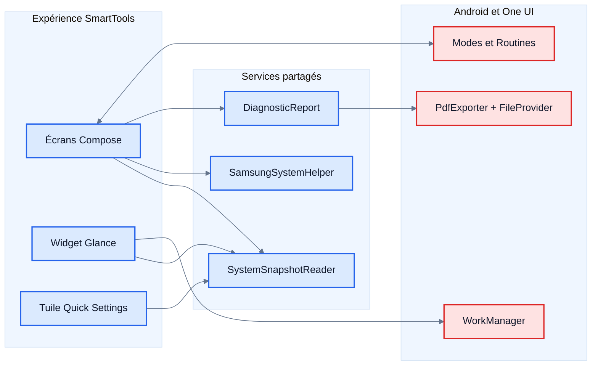
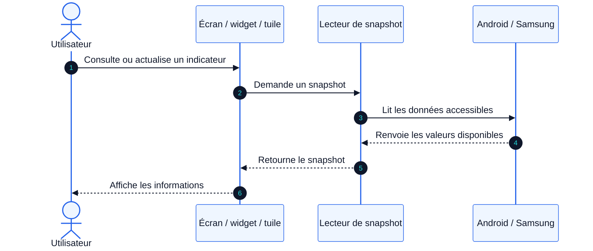

<a id="top"></a>

<div align="center">

# ⚡ SmartTools

### **L’essentiel du diagnostic Galaxy, dans une interface pensée pour One UI.**

Une boîte à outils Android moderne pour **comprendre**, **tester** et **piloter** votre Samsung Galaxy — du diagnostic matériel au widget, en passant par les tests OLED, tactiles et S-Pen.

**Open source · Sans publicité · Sans télémétrie · Conçue pour Samsung Galaxy**

<br/>

[](https://github.com/teremuhamblin/SmartTools/releases)
[](#compatibilite)
[](#compatibilite)
[](#architecture)

[](https://github.com/teremuhamblin/SmartTools/commits/main)
[](https://github.com/teremuhamblin/SmartTools/issues)
[](LICENSE)

<br/>

[**Nouveautés v1.2.1**](#nouveautes) · [**Fonctionnalités**](#fonctionnalites) · [**Architecture**](#architecture) · [**Historique**](#historique) · [**Installation**](#installation) · [**Sécurité**](#securite)

</div>

---

> **Identité visuelle** — une esthétique inspirée des interfaces IA modernes : surfaces sobres, contrastes nets, accents **bleu électrique** pour la technologie et **rouge** pour les alertes et la sécurité. GitHub impose sa propre police dans le rendu Markdown ; le README privilégie donc la hiérarchie typographique native, les tableaux, les badges et les diagrammes.

## Sommaire

- [À propos](#apropos)
- [Nouveautés v1.2.1](#nouveautes)
- [Fonctionnalités principales](#fonctionnalites)
- [Architecture](#architecture)
- [Historique des versions](#historique)
- [Compatibilité](#compatibilite)
- [Installation et compilation](#installation)
- [Confidentialité et sécurité](#securite)
- [Contribuer](#contribuer)
- [Licence](#licence)

---

<a id="apropos"></a>
## 📖 À propos

**SmartTools** est une application Android open source développée en **Kotlin**, **Jetpack Compose** et **Jetpack Glance**, dédiée aux smartphones, tablettes et appareils pliables **Samsung Galaxy**.

Elle réunit dans une seule expérience les informations utiles sur l’appareil, des outils de test matériel, des raccourcis d’optimisation et des intégrations à l’écosystème **One UI**. L’interface est conçue pour être lisible, adaptée aux formats Galaxy et cohérente avec les usages Samsung.

| | Ce que SmartTools apporte |
|:--|:--|
| **Diagnostiquer** | Informations appareil, mémoire, batterie et état thermique disponible. |
| **Tester** | Outils interactifs pour l’écran OLED, le tactile et le S-Pen compatible. |
| **Consulter** | Widget d’accueil et tuile de réglages rapides pour accéder aux indicateurs. |
| **Automatiser** | Raccourcis et alertes utilisables avec Samsung Modes et Routines. |
| **Partager** | Rapport de diagnostic exportable au format PDF. |

---

<a id="nouveautes"></a>
## 🚀 Nouveautés de la v1.2.1 — Stable

> [!IMPORTANT]
> **v1.2.1 est une mise à jour de maintenance et d’alignement de version.** Elle conserve les fonctionnalités de la v1.2.0 ; elle n’introduit pas de nouvelle fonctionnalité ni ne prétend à des correctifs applicatifs non documentés.

- **Version Android synchronisée :** `versionName` passe à `1.2.1` et `versionCode` à `111`.
- **Documentation harmonisée :** README, changelog, suivi de version et feuille de route indiquent le même numéro.
- **Base fonctionnelle conservée :** widget, Modes et Routines, test OLED/tactile/S-Pen, tuile rapide et rapports PDF restent ceux de la v1.2.0.

> **Publication de l’APK :** ce commit met à jour le dépôt source. La disponibilité d’un APK v1.2.1 dépend de sa compilation et de sa publication dans [Releases](https://github.com/teremuhamblin/SmartTools/releases). Les tests n’ont pas été exécutés depuis cette modification documentaire/versionnée.

### Fonctionnalités introduites en v1.2.0

- **Widget One UI :** Jetpack Glance, formats `2×1` et `4×1`, indicateurs de mémoire, batterie et température, actualisation à la demande et via WorkManager.
- **Modes et Routines :** App Shortcuts, liens profonds `smarttools://route/...` et canaux d’alertes.
- **Tests interactifs :** mires d’écran OLED, matrice tactile multi-touch et prise en charge des informations S-Pen lorsque le matériel le permet.
- **Rapports et tuile rapide :** résultats de diagnostic intégrés au rapport PDF et indicateurs partagés avec `QuickTileService`.

---

<a id="fonctionnalites"></a>
## ✨ Fonctionnalités principales

| Domaine | Fonctionnalités |
|:--|:--|
| 🔍 **Diagnostic matériel** | Informations sur l’appareil, Android/One UI, processeur, mémoire, stockage et batterie ; données thermiques selon les API disponibles ; lecture de l’état Knox lorsque pris en charge. |
| 📊 **Widget One UI** | Indicateurs de mémoire, batterie et température ; formats `2×1` et `4×1` ; actualisation manuelle et planifiée. |
| 🖊️ **Test de l’écran** | Mires OLED, test multi-touch, événements S-Pen et retour visuel interactif. |
| ⚡ **Accès rapide** | Tuile Quick Settings et outils d’optimisation accessibles depuis l’application. |
| ⚙️ **Automatisation** | Seuils et profils de l’application, raccourcis et intégration à Samsung Modes et Routines. |
| 📄 **Rapport** | Export PDF des informations et résultats de diagnostic pris en charge. |
| 🎨 **Expérience Galaxy** | Interface Jetpack Compose, cartes One UI, thème AMOLED noir et traductions FR/EN/ES. |

---

<a id="architecture"></a>
## 🏗️ Architecture

Un lecteur de snapshot système commun partage les indicateurs entre les écrans, le widget et la tuile rapide. Les composants d’interface délèguent les tâches dédiées aux utilitaires, aux services Android et aux intégrations One UI.





<details>
<summary><strong>📂 Arborescence principale de <code>app/src/</code></strong></summary>

```text
app/src/
├── main/
│   ├── AndroidManifest.xml
│   ├── java/com/smarttools/samsung/
│   │   ├── MainActivity.kt
│   │   ├── data/ (DeviceSpecs.kt, DiagnosticReport.kt)
│   │   ├── service/ (QuickTileService.kt)
│   │   ├── widget/ (SmartToolsWidget.kt, Receiver, Worker)
│   │   ├── theme/ (Color.kt, Theme.kt)
│   │   ├── ui/
│   │   │   ├── components/ (OneUiCard.kt, ThermalGauge.kt, TouchMatrixView.kt)
│   │   │   └── screens/ (Automation, Diagnostic, Optimization, TouchTest)
│   │   ├── utils/ (BatteryHelper, PdfExporter, QuickSystemSnapshot,
│   │   │          RoutineNotifier, SamsungSystemHelper)
│   └── res/xml/ (file_paths.xml, shortcuts.xml, widget info)
└── test/java/com/smarttools/samsung/DiagnosticReportTest.kt
```

</details>

---

<a id="historique"></a>
## 📜 Historique des versions

| Version | Date | Résumé |
|:--:|:--:|:--|
| **v1.2.1** | 26 nov. 2026 | **Stable · Maintenance** : version Android `1.2.1` / code `111` et documentation harmonisée ; aucune nouvelle fonctionnalité annoncée. |
| **v1.2.0** | Nov. 2026 | Widget Jetpack Glance, Modes et Routines, tests OLED/tactile/S-Pen et rapports enrichis. |
| **v1.1.0** | Fév. 2025 | Export PDF, tuile Quick Settings, automatisations et langues FR/EN/ES. |
| **v1.0.3** | Jan. 2025 | Alertes de charge, indicateurs d’optimisation et cible Android 15 (SDK 35). |
| **v1.0.2** | Déc. 2024 | État Knox, jauge thermique, thème AMOLED et améliorations Galaxy Z Flip. |
| **v1.0.1** | Déc. 2024 | Compatibilité Android 8–10, permissions de notification et adaptations d’affichage. |
| **v1.0.0** | Nov. 2024 | Première version : Diagnostic, Optimisation et Automatisation. |

---

<a id="compatibilite"></a>
## 📱 Compatibilité

- **Appareils ciblés :** smartphones Samsung Galaxy, Galaxy Z Flip, Galaxy Z Fold et tablettes Galaxy Tab.
- **Android minimum :** Android 8.0 (**API 26**).
- **Versions One UI visées :** One UI 4.x à 7.x.
- **S-Pen :** les fonctions dépendent de la compatibilité matérielle de l’appareil et du stylet.

La disponibilité et la précision de certaines données système peuvent varier selon le modèle, la version Android et les API exposées par le fabricant.

---

<a id="installation"></a>
## 📲 Installation et compilation

### Installer une version publiée

1. Ouvrez la page [**Releases**](https://github.com/teremuhamblin/SmartTools/releases).
2. Téléchargez l’APK de la version souhaitée lorsqu’il est disponible et installez-le sur votre Galaxy.
3. Pour ajouter le widget : appui long sur l’écran d’accueil → **Widgets** → **SmartTools**.
4. Pour les intégrations, ouvrez **Automatisation** et consultez les raccourcis Modes et Routines disponibles.

> Installez les APK uniquement depuis une source de confiance et vérifiez la version indiquée dans les Releases.

<details>
<summary><strong>🛠️ Compiler le projet et lancer les tests</strong></summary>

Prérequis : environnement Android compatible avec le projet et JDK configuré.

```bash
git clone https://github.com/teremuhamblin/SmartTools.git
cd SmartTools
./gradlew test
./gradlew assembleDebug
```

</details>

---

<a id="securite"></a>
## 🔒 Confidentialité et sécurité

- 🛡️ **Pas de publicité ni de télémétrie annoncée.** L’application est conçue sans collecte analytique ni suivi par des services tiers.
- 📡 **Fonctionnement local annoncé.** Les diagnostics s’appuient sur les informations accessibles à l’appareil ; consultez le manifeste et les dépendances pour vérifier la version compilée.
- 🔐 **Knox en lecture seule.** SmartTools consulte l’état disponible et n’altère pas le bit Knox.
- 📂 **Partage de rapports limité.** Le `FileProvider` est configuré pour exposer le dossier de rapports plutôt que l’ensemble du stockage interne.
- 🔋 **Tâches en arrière-plan maîtrisées.** Les mises à jour du widget reposent sur WorkManager et sont associées à son cycle d’utilisation.
- 👀 **Permissions contextualisées.** Les notifications nécessitent l’autorisation correspondante sur Android 13+.

**Pour les mainteneurs :** vérifiez le manifeste, les chemins `FileProvider`, les dépendances et les composants exportés lors de chaque évolution. Ces informations décrivent l’intention du projet et ne remplacent pas un audit de sécurité indépendant.

---

<a id="contribuer"></a>
## 🤝 Contribuer

Les contributions, rapports de bugs et propositions d’amélioration sont les bienvenus : ouvrez une issue, créez une branche dédiée, ajoutez les tests pertinents, lancez `./gradlew test`, puis soumettez une Pull Request décrivant les changements et leur validation.

---

<a id="licence"></a>
## 📄 Licence

Ce projet est distribué sous licence **MIT**. Consultez le fichier [`LICENSE`](LICENSE) pour les conditions complètes.

---

<div align="center">

**Fait avec ☕ et Kotlin pour Samsung Galaxy**  
**SmartTools v1.2.1 Stable** · [⬆️ Retour en haut](#top)

</div>
