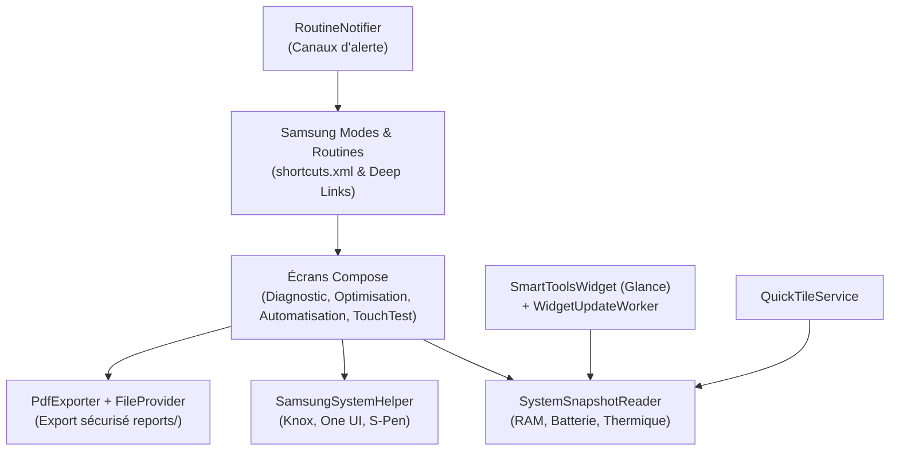

<a id="top"></a>
<div align="center">

# ⚡ SmartTools
### La boîte à outils Android moderne, légère et conçue sur mesure pour Samsung Galaxy (One UI)

Diagnostic matériel de précision, widget natif One UI, intégration **Modes et Routines** et test interactif **OLED / Tactile / S-Pen** — sans publicité ni tracking.

<br/>

<!-- Badges Statut & Version -->

-2563EB?style=for-the-badge&logo=android&logoColor=white&labelColor=1E293B)

-0284C7?style=for-the-badge&logo=kotlin&logoColor=white&labelColor=1E293B)

<!-- Badges Dynamiques GitHub -->
[](https://github.com/teremuhamblin/SmartTools/commits)
[](https://github.com/teremuhamblin/SmartTools/issues)
[](LICENSE)

<br/>

[🚀 Nouveautés v1.2.0](#nouveautes) • [✨ Fonctionnalités](#fonctionnalites) • [🏗️ Architecture](#architecture) • [📜 Historique](#historique) • [📲 Installation](#installation) • [🔒 Sécurité](#securite) • [🤝 Contribuer](#contribuer)

</div>

---

<a id="apropos"></a>
## 📖 À propos

**SmartTools** est une application open-source développée en **Kotlin**, **Jetpack Compose** et **Jetpack Glance**, dédiée aux smartphones, tablettes et modèles pliables **Samsung Galaxy**.

Sans publicité, sans télémétrie et sans service invasif en arrière-plan, elle adopte les codes esthétiques de **One UI** pour **diagnostiquer**, **optimiser** et **automatiser** votre appareil au quotidien.

---

<a id="nouveautes"></a>
## 🚀 Nouveautés de la v1.2.0

> [!IMPORTANT]
> La **v1.2.0** renforce l'intégration native à l'écosystème Samsung One UI avec 3 nouveaux modules majeurs et une architecture unifiée.

* 📊 **Widget écran d'accueil One UI (`SmartToolsWidget`) :**
  * Développé avec **Jetpack Glance (`1.2.0`)**, coins arrondis `24dp` et **Dynamic Color** (thème clair/sombre automatique).
  * Formats responsives **`2×1` (compact)** et **`4×1` (détaillé)** affichant RAM utilisée, Mo libres, batterie, température °C et statut thermique.
  * Bouton d'actualisation instantanée **`↻`** + planification économe via **`WorkManager`** (active *uniquement* si un widget est placé sur l'écran d'accueil).
* ⚙️ **Intégration Samsung *Modes et Routines* (ex-Bixby Routines) :**
  * **3 App Shortcuts natifs** (`shortcuts.xml`) directement appelables dans vos routines (*Diagnostic rapide*, *Test Écran/S-Pen*, *Optimisation*).
  * **Deep Links** (`smarttools://route/...`) et **canaux d'alertes déclencheurs** (`RoutineNotifier` : surchauffe batterie / RAM critique) pour déclencher des actions One UI automatiques.
* ✍️ **Module de test interactif Écran OLED, Tactile & Numériseur S-Pen :**
  * **Mires OLED & Burn-in :** plein écran immersif autour du poinçon caméra (`CUTOUT_MODE_SHORT_EDGES`), luminosité temporaire à `100 %` restaurée à la sortie, cycle de 6 couleurs (RVB, Blanc, Noir OLED, Gris 50 %).
  * **Matrice Tactile (`10×20`) :** suivi multi-touch à **120/240 Hz** (`getHistoricalX/Y`) avec blocage du geste *Retour* latéral One UI (`setSystemGestureExclusionRects`).
  * **Télémétrie S-Pen (Wacom EMR) :** rejet de paume natif (`TOOL_TYPE_STYLUS` / `TOOL_TYPE_ERASER`), pression, inclinaison (`AXIS_TILT`), survol *Air View* (`OnHoverListener`) et bouton latéral.
* 📄 **Rapports & Tuile Rapide enrichis :**
  * Intégration des résultats **Écran & S-Pen** dans `DiagnosticReport` et l'export **`PdfExporter`**.
  * Sous-titre dynamique (RAM % & Température) sur la tuile **`QuickTileService`** via le lecteur unifié `SystemSnapshotReader`.

---

<a id="fonctionnalites"></a>
## ✨ Fonctionnalités principales

| Pôle | Capacités clés |
| :--- | :--- |
| 🔍 **Diagnostic matériel** | Télémétrie batterie + jauge thermique (`ThermalGauge` & `PowerManager` API 29+), modèle, CPU, Android/One UI, bit **Samsung Knox** (`0x0` / `0x1`), RAM/stockage, test **OLED / Tactile / S-Pen** et export **PDF** |
| 📊 **Widget One UI** | Indicateur temps réel RAM, batterie & température sur l'écran d'accueil (`2×1` / `4×1`), rafraîchissement à la demande, zéro surconsommation |
| ⚡ **Optimisation rapide** | Libération mémoire ciblée, gestion du cache et **Tuile Quick Settings** One-Tap dans le volet de raccourcis One UI |
| ⚙️ **Automatisation & Routines** | Seuils batterie (80 % / 85 %), Mode Nuit Éco (23h–07h), Profil Jeu, **App Shortcuts** & alertes **Samsung Modes et Routines** |
| 🎨 **Design One UI & Multilingue** | Cartes `OneUiCard` (`26dp`), thème **Pure AMOLED Black (`#000000`)**, adaptatif Galaxy S / Z Flip / Z Fold / Tab, interface **FR / EN / ES** |

---

<a id="architecture"></a>
## 🏗️ Architecture du projet



<details>
<summary><b>📂 Explorer l'arborescence complète de <code>app/src/</code> (cliquer pour déplier)</b></summary>

```text
app/src/
├── main/
│   ├── AndroidManifest.xml
│   ├── java/com/smarttools/samsung/
│   │   ├── MainActivity.kt                  # Navigation & routage Deep Links
│   │   ├── data/
│   │   │   ├── DeviceSpecs.kt               # Spécifications appareil & S-Pen
│   │   │   └── DiagnosticReport.kt          # Modèle complet (+ résultats écran/S-Pen)
│   │   ├── service/
│   │   │   └── QuickTileService.kt          # Tuile Réglages Rapides One UI
│   │   ├── widget/
│   │   │   ├── SmartToolsWidget.kt          # Widget Glance 2×1 & 4×1
│   │   │   ├── SmartToolsWidgetReceiver.kt  # Cycle de vie widget (onEnabled/onDisabled)
│   │   │   └── WidgetUpdateWorker.kt        # Planification WorkManager (15 min)
│   │   ├── theme/
│   │   │   ├── Color.kt & Theme.kt          # Thème One UI & Pure AMOLED Black
│   │   ├── ui/
│   │   │   ├── components/
│   │   │   │   ├── OneUiCard.kt
│   │   │   │   ├── ThermalGauge.kt
│   │   │   │   └── TouchMatrixView.kt       # Canvas 120/240 Hz tactile & S-Pen
│   │   │   └── screens/
│   │   │       ├── AutomationScreen.kt      # Profils & hub Modes et Routines
│   │   │       ├── DiagnosticScreen.kt      # Télémétrie & lancement tests
│   │   │       ├── OptimizationScreen.kt    # Nettoyage RAM & cache
│   │   │       └── TouchTestScreen.kt       # Mode immersif OLED / Tactile / S-Pen
│   │   └── utils/
│   │       ├── BatteryHelper.kt
│   │       ├── PdfExporter.kt
│   │       ├── QuickSystemSnapshot.kt       # Snapshot unifié RAM / Batterie / Thermique
│   │       ├── RoutineNotifier.kt           # Notifications déclencheurs Routines
│   │       └── SamsungSystemHelper.kt
│   └── res/xml/
│       ├── file_paths.xml                   # FileProvider restreint à reports/
│       ├── shortcuts.xml                    # App Shortcuts Modes & Routines
│       └── smart_tools_widget_info.xml      # Configuration taille/arrondis Widget
└── test/java/com/smarttools/samsung/
    └── DiagnosticReportTest.kt              # Tests unitaires
```

</details>

---

<a id="historique"></a>
## 📜 Historique des versions (`v1.0.0` → `v1.2.0`)

| Version | Date | Résumé des modifications |
| :---: | :---: | :--- |
| **v1.2.0** | Nov 2026 | **Écosystème One UI & Diagnostics avancés** : Widget écran d'accueil **Jetpack Glance** (`2×1`/`4×1` + `WorkManager`), intégration native **Samsung Modes & Routines** (`shortcuts.xml`, Deep Links, `RoutineNotifier`), module interactif **OLED / Matrice Tactile 120–240 Hz / Numériseur S-Pen**, `SystemSnapshotReader` unifié, export PDF enrichi et tests unitaires (`DiagnosticReportTest`). |
| **v1.1.0** | Fév 2025 | **Majeure Mineure** : Export de rapport PDF (`PdfExporter`), tuile Quick Settings (`QuickTileService`), moteur de règles d'automatisation, support multilingue (FR/EN/ES) et alignement visuel One UI 6.1/7.0. |
| **v1.0.3** | Jan 2025 | **Protection & SDK 35** : Alerte de charge programmable à 80 %/85 %, indicateurs circulaires dans l'optimisation, Android 15 (Target SDK 35) et précision accrue des cycles batterie. |
| **v1.0.2** | Déc 2024 | **Matériel & AMOLED** : Vérification du bit Knox (`0x0`/`0x1`), jauge thermique temps réel (`ThermalGauge`), mode Pure AMOLED Black et correctif Galaxy Z Flip. |
| **v1.0.1** | Déc 2024 | **Stabilisation & Formats** : Rétrocompatibilité Android 8–10, permissions Android 13/14 (`POST_NOTIFICATIONS`), correctif calcul RAM et paddings adaptatifs Fold/Tab. |
| **v1.0.0** | Nov 2024 | **Sortie Initiale** : Socle Jetpack Compose One UI (`OneUiCard`), écrans Diagnostic, Optimisation et Automatisation, utilitaires `BatteryHelper` et `SamsungSystemHelper`. |

---

<a id="compatibilite"></a>
## 📱 Prérequis de compatibilité

* **Appareils cibles :** Smartphones, pliables (Z Flip / Z Fold) et tablettes (Tab S avec S-Pen) **Samsung Galaxy**
* **Version minimale d'Android :** Android 8.0 (API 26 — Oreo)
* **Version recommandée :** Android 14 / Android 15 (**One UI 4.0 à One UI 7.x**)

---

<a id="installation"></a>
## 📲 Installation & Prise en main rapide

1. Rendez-vous dans la section [**Releases**](https://github.com/teremuhamblin/SmartTools/releases).
2. Téléchargez le dernier APK **`SmartTools-v1.2.0.apk`** et installez-le sur votre Galaxy.
3. **Ajoutez le Widget One UI :** appui long sur l'écran d'accueil ➔ *Widgets* ➔ *SmartTools* (`2×1` ou `4×1`).
4. **Configurez vos Routines :** ouvrez *Automatisation* ➔ *Ouvrir Modes & Routines* pour associer vos déclencheurs et actions SmartTools.
5. **Testez votre dalle & S-Pen :** rendez-vous dans *Diagnostic* ➔ *Test Écran OLED, Tactile & S-Pen* avant d'exporter votre **rapport PDF** complet !

<details>
<summary><b>🛠️ Compiler depuis les sources & exécuter les tests (Développeurs)</b></summary>

```bash
# Cloner le dépôt
git clone https://github.com/teremuhamblin/SmartTools.git
cd SmartTools

# Lancer les tests unitaires
./gradlew test

# Compiler l'APK Debug
./gradlew assembleDebug
```

</details>

---

<a id="securite"></a>
## 🔒 Confidentialité & Sécurité

* 🛡️ **100 % Hors-ligne :** zéro télémétrie, zéro publicité, aucune requête réseau vers un serveur tiers.
* 🔐 **Respect total du Knox :** lecture seule des métriques système, aucune altération du bit Knox (`0x0`).
* 📂 **Partage PDF cloisonné :** `FileProvider` strictement limité au sous-dossier interne `reports/` (`file_paths.xml`).
* 🔋 **Respect de la batterie :** le `WorkManager` du widget s'arrête automatiquement dès qu'aucun widget n'est actif sur l'écran d'accueil.
* 👀 **Permissions transparentes :** `POST_NOTIFICATIONS` (Android 13+) demandée uniquement pour les alertes Batterie / *Modes et Routines* ; visibilité `<queries>` restreinte à `com.samsung.android.app.routines`.

---

<a id="contribuer"></a>
## 🤝 Contribuer

Les contributions, signalements de bugs et suggestions sont les bienvenus !

1. Forkez le dépôt.
2. Créez votre branche : `git checkout -b feature/NouvelleFonctionnalite`
3. Commitez vos modifications : `git commit -m 'feat: ajout de la fonctionnalité X'`
4. Poussez sur votre branche : `git push origin feature/NouvelleFonctionnalite`
5. Ouvrez une **Pull Request**.

---

## 📄 Licence

Ce projet est distribué sous licence **MIT**. Consultez le fichier [`LICENSE`](LICENSE) pour plus d'informations.

---

<div align="center">

Fait avec ☕ et **Kotlin** pour **Samsung Galaxy** • **v1.2.0** • [⬆️ Retour en haut](#top)

</div>
