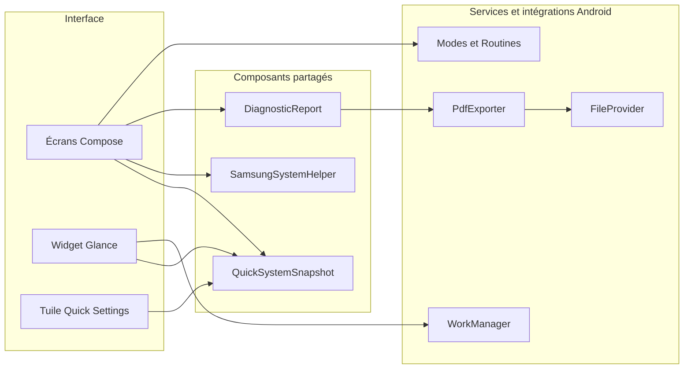

# Architecture de SmartTools

SmartTools est une application Android construite avec **Kotlin**, **Jetpack Compose** et **Jetpack Glance**. Cette page décrit les composants visibles dans le dépôt et leurs relations, sans présumer d’une architecture ou de garanties qui ne sont pas confirmées par le code.

## Vue d’ensemble



## Composants

| Composant | Rôle |
|:--|:--|
| `MainActivity.kt` | Point d’entrée de l’application et navigation vers les écrans. |
| `ui/screens/` | Écrans de diagnostic, optimisation, automatisation et test d’écran. |
| `ui/components/` | Composants visuels, dont la jauge thermique et la matrice tactile. |
| `QuickSystemSnapshot.kt` | Lecture partagée des indicateurs système utilisés par plusieurs surfaces. |
| `SamsungSystemHelper.kt` | Fonctions de lecture liées aux appareils et API Samsung disponibles. |
| `widget/` | Widget d’accueil Glance, son receiver et son worker de mise à jour. |
| `QuickTileService.kt` | Tuile de réglages rapides Android. |
| `DiagnosticReport.kt` et `PdfExporter.kt` | Modèle et export des informations de diagnostic prises en charge. |
| `RoutineNotifier.kt` et `res/xml/shortcuts.xml` | Notifications et raccourcis liés à Modes et Routines. |
| `res/xml/file_paths.xml` | Configuration des chemins exposés par le `FileProvider`. |

## Principes de mise en œuvre

- Les données affichées peuvent varier selon le modèle, la version Android et les API accessibles.
- Les fonctionnalités widget et tuile réutilisent des informations système communes.
- Les tâches planifiées s’appuient sur WorkManager.
- Les exports sont partagés via le `FileProvider` configuré par l’application.
- Les changements touchant aux permissions, aux composants exportés ou aux chemins de partage doivent être examinés et testés avant publication.

## Vérifications conseillées

```bash
./gradlew test
./gradlew assembleDebug
```

Les commandes supposent qu’un wrapper Gradle est présent à la racine du dépôt. Sinon, ouvrez le projet dans Android Studio et utilisez la configuration Gradle du projet.
